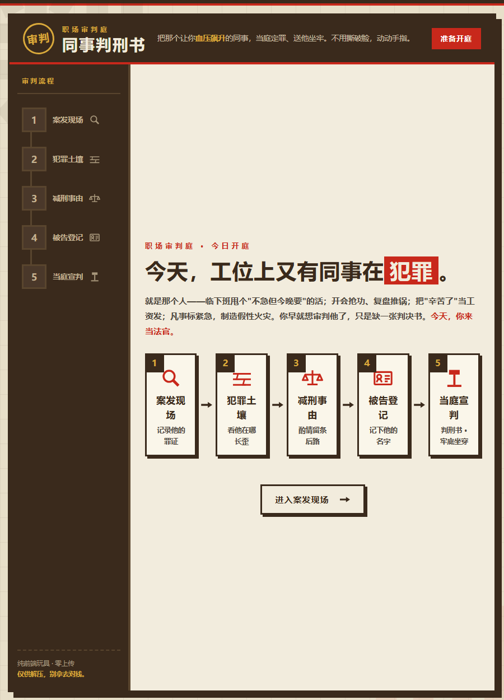

# 同事判刑书

> 你工位对面那个人，今天开庭。
> 有期徒刑三年，缓期一个世纪。

[](./LICENSE) [](./assets/workplace-verdict.html) [](./SKILL.md)

**🔗 [在线体验 →](https://tomatoribs.github.io/workplace-verdict/)**（点开就玩 · 免安装 · 免注册）



一个 73 KB 的单文件 HTML，双击就开，断网也能玩，手机浏览器直接适配。页面左下角写着它的护栏：**仅供解压，别拿去对线。**

临下班甩个「不急但今就要」的活，开会抢功、复盘甩锅；把「辛苦了」当工资发；凡事标紧急，制造假性火灾。你早就想审判他了，只缺一张判决书。

**5 步向导 · 10 条罪证 · 5 大罪名轴 · 三档罪级 · 0 上传**

## 你会判出什么

| 定罪依据 | 罪名举例 |
|---|---|
| 冒功罪 | 冒功惯犯罪 · 会议抢功罪 · 成果收割罪 |
| 怠工罪 | 怠工摸鱼罪 · 工位幽灵罪 · 带薪隐身罪 · 产出蒸发罪 |
| 甩锅罪 | 甩锅惯犯罪 · 责任逃逸罪 · 职场背锅分销罪 · 甩锅界扛把子罪 |
| 画饼PUA罪 | 鸡汤投毒罪 · 道德绑架罪 · 为你好施法罪 |
| 谎报军情罪 | 焦虑批发罪 · 狼来了惯犯罪 · 假性火灾纵火罪 |

罪级三档：**罪大恶极** / **重罪** / **轻罪（但恶心）**。10 条罪证怎么勾，决定他踩中哪条罪名轴、判几年。

## 开庭流程

5 步走完，当庭宣判：**案发现场**（记录他的罪证）→ **犯罪土壤**（看他哪里长歪）→ **减刑事由**（酌情留条后路）→ **被告登记**（可留空）→ **当庭宣判**（判刑书，牢底坐穿）。

判决全部动态生成：10 条罪证映射 5 大罪名轴，每次组合不同，罪名、刑期、判词也跟着变。Canvas 手绘的竖版判刑书，盖「有罪」红印（恶搞设计），可下载 PNG、复制全文、生成分享链接。

## 效果示例

```text
┌────────────────────────────────────────────┐
│  职场审判庭 · 判刑书                        │
├────────────────────────────────────────────┤
│  被告：被告某同事                           │
│  罪名：职场背锅分销罪                       │
│  定罪依据：甩锅罪                           │
│  罪级：重罪                                 │
│  刑期：有期徒刑三年，缓期一个世纪            │
│  减刑事由：（无从轻，死不足惜）             │
├────────────────────────────────────────────┤
│                  〔 有 罪 〕               │
└────────────────────────────────────────────┘
```

> 罪名、刑期、判词由你的勾选动态生成，以上为示例输出。

## 怎么用

1. 双击 `assets/workplace-verdict.html`（零依赖、离线可跑，手机可直接打开）。
2. 走完 5 步：选罪证 → 选犯罪土壤 → 选减刑事由 → 登记被告 → 当庭宣判。
3. 存 PNG、复制全文或生成链接，发给信得过的朋友笑一笑。

## 隐私

选项只存在于浏览器本地，不联网、不上传。被告姓名留空则显示「被告某同事」；**如果填了，姓名会随分享链接一起编码出去**——所以我们没有理由建议你填真实姓名。判完之后留下的应当是笑声，不是能被翻出来的东西。

## 别拿它干什么

- 不要填真实姓名，用化名或留空
- 不要发进公司群，不要 @ 本人
- 不要作为绩效评议、人事材料或任何正式场合的依据
- 如果那位同事其实是替你背锅的人——建议先判自己

## 工位生存指南 · 六件套

| 现在的状况 | 玩哪个 | 花多久 |
|---|---|---|
| 想给某个同事开庭 | **同事判刑书（你在这）** | 3 分钟 |
| 想知道消耗的源头是谁 | [上司图鉴](https://github.com/TomatoRibs/shangsi-tujian) | 3 分钟 |
| 想知道到底有多想走 | [跑路指数测试](https://github.com/TomatoRibs/want-to-quit-index) | 6 分钟 |
| 只想先给环境做个体检 | [工位窒息指数](https://github.com/TomatoRibs/workplace-suffocation-index) | 30 秒 |
| 什么也不想干 | [摸鱼签筒](https://github.com/TomatoRibs/moyu-qiantong) | 摇一签 |
| 下午有一场会 | [车祸大会 Bingo](https://github.com/TomatoRibs/huoche-dahui-bingo) | 一场会 |

## 可二创

罪名、刑期、判词集中在 `assets/workplace-verdict.html` 源码的 charges / sentences 数组里——换成你们公司的黑话毫无门槛，那就是「你们部门的法庭」。

## 为什么做这个

职场里有些气，举报不够格、吵架不值得、憋着又伤身。那就开庭——把他说过的话、干过的事，一条条列成罪证，判他个「轻罪（但恶心）」。至少盖那枚红印的时候，是爽的。

## 装成 WorkBuddy 技能（可选）

```bash
bash scripts/install_local.sh .
```

WorkBuddy 是一个本地 AI 助手；装成技能后，一句话触发：「做一个能判决 10 条罪证、5 大罪名轴的判刑书网页」。

## 免责声明

本产品为原创解压玩具，所有罪名、刑期、判词均为**虚构文学创作**。被告栏请使用化名或留空，请勿填写真实姓名；产物非司法文书，印章与版式为恶搞设计，与任何真实机构无关，**不得**用于实名指控、绩效评议、人事材料或任何正式场合。非标准化量表，未做信效度检验，不构成对任何人的评价。

## 作者 · 许可证

番茄排骨 · [MIT](./LICENSE)

判完顺手点个 Star，让下一个想开庭的人能找到法庭。

> 判他，是为了放过自己。
